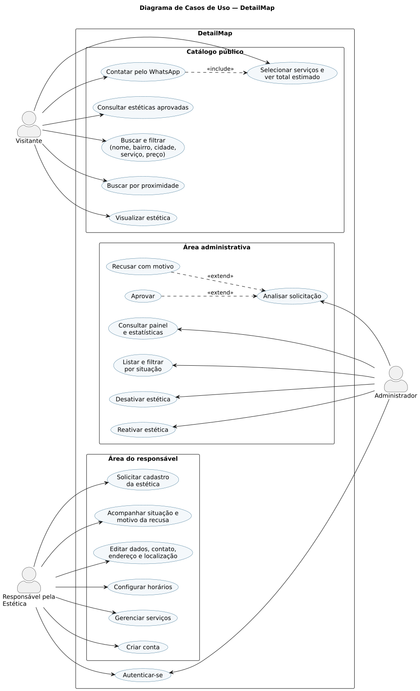
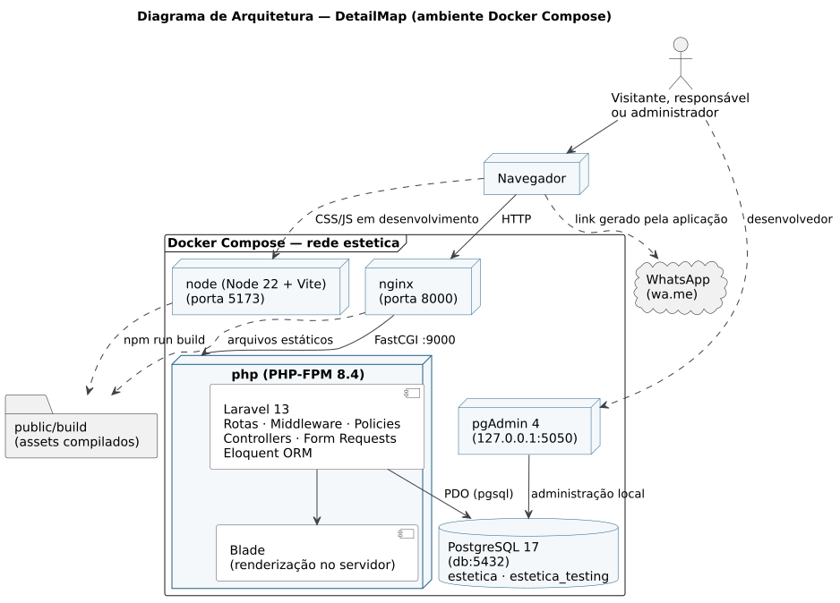
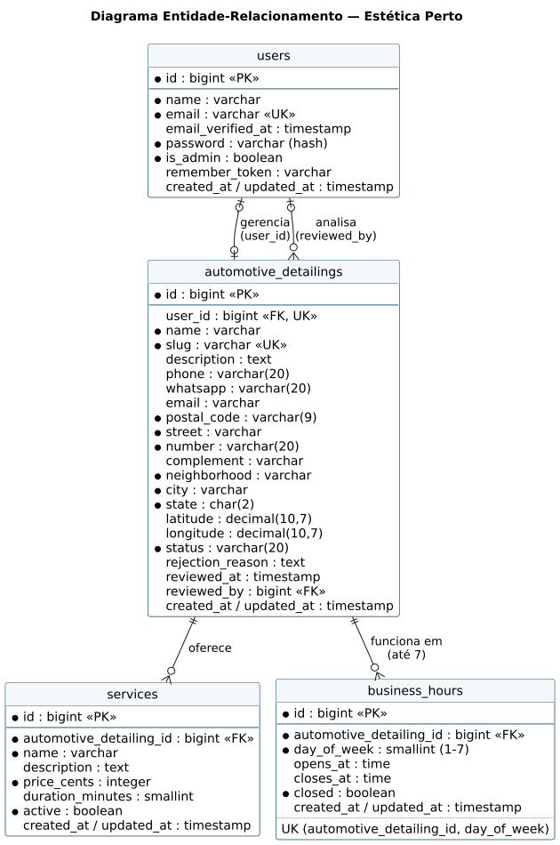

# DetailMap

**Encontre a estética automotiva ideal perto de você.**

Plataforma para encontrar estéticas automotivas, comparar serviços e entrar em contato diretamente pelo WhatsApp, desenvolvida como Trabalho de Conclusão de Curso.

## Sumário

1. [Descrição do projeto](#descrição-do-projeto)
2. [Problema](#problema)
3. [Justificativa](#justificativa)
4. [Tecnologias utilizadas](#tecnologias-utilizadas)
5. [Regras de negócio](#regras-de-negócio)
6. [Requisitos Funcionais](#requisitos-funcionais)
7. [Requisitos Não Funcionais](#requisitos-não-funcionais)
8. [Casos de Uso](#casos-de-uso)
9. [Diagramas](#diagramas)
10. [Arquitetura do sistema](#arquitetura-do-sistema)
11. [Estrutura do projeto](#estrutura-do-projeto)
12. [Pré-requisitos](#pré-requisitos)
13. [Como executar o projeto](#como-executar-o-projeto)
14. [Configuração do ambiente](#configuração-do-ambiente)
15. [Atualizando um ambiente existente](#atualizando-um-ambiente-existente)
16. [Banco de dados](#banco-de-dados)
17. [pgAdmin](#pgadmin)
18. [Testes](#testes)
19. [Segurança](#segurança)
20. [Rotas e fluxos principais](#rotas-e-fluxos-principais)
21. [Estado final do projeto](#estado-final-do-projeto)

## Descrição do projeto

O **DetailMap** é uma plataforma web para descoberta de estéticas automotivas. Qualquer pessoa pode consultar os estabelecimentos cadastrados, comparar serviços e preços, verificar endereço e horário de funcionamento e iniciar uma conversa com a estética pelo WhatsApp, sem precisar criar conta.

O sistema possui três perfis de uso:

- **Visitante:** consulta o catálogo, busca, filtra, localiza estéticas próximas, seleciona serviços para estimar o valor e entra em contato.
- **Responsável pela estética:** cria uma conta, solicita o cadastro do estabelecimento e mantém seus dados, horários e serviços.
- **Administrador:** analisa as solicitações de cadastro e controla quais estéticas ficam visíveis no catálogo.

A plataforma atua apenas como ponte entre cliente e estabelecimento. Não há pagamento, pedido, agendamento ou chat interno: a negociação acontece diretamente entre as partes.

## Problema

Quem procura uma estética automotiva costuma encontrar informações dispersas em redes sociais, mapas, sites próprios e indicações pessoais. Em geral:

- os serviços oferecidos e o que cada um inclui não estão descritos de forma clara;
- os preços raramente são publicados, o que obriga o cliente a contatar vários estabelecimentos para comparar;
- endereço, horário de funcionamento e canal de contato aparecem em locais diferentes, muitas vezes desatualizados;
- não existe um ponto central em que seja possível buscar por bairro, cidade ou tipo de serviço e comparar estabelecimentos próximos.

Do lado dos estabelecimentos, especialmente os pequenos, manter presença digital organizada exige tempo e conhecimento técnico que nem sempre estão disponíveis.

## Justificativa

Centralizar as informações das estéticas em um único catálogo reduz o esforço necessário para encontrar um fornecedor adequado. O projeto se justifica pelos seguintes benefícios:

- **Centralização:** dados de contato, endereço, horários, serviços e preços reunidos em uma única página por estabelecimento.
- **Facilidade de descoberta:** busca textual, filtros por cidade, serviço e faixa de preço, e ordenação por proximidade a partir da localização do visitante.
- **Transparência:** cada serviço é publicado com descrição, duração estimada e preço, permitindo comparação antes do contato.
- **Contato direto:** o visitante seleciona os serviços de interesse e abre uma conversa no WhatsApp com a lista e o total estimado já preenchidos.
- **Presença digital para pequenas estéticas:** o responsável mantém a própria página sem conhecimento técnico, por meio de um painel simples.
- **Confiabilidade do catálogo:** somente estéticas aprovadas pela administração ficam visíveis, o que reduz cadastros incorretos ou indevidos.

## Tecnologias utilizadas

| Tecnologia | Versão | Função no projeto |
|---|---|---|
| PHP | 8.4 | Linguagem da aplicação no servidor. |
| Laravel | 13 | Framework MVC: rotas, middleware, autenticação, autorização (policies e gates), validação, Eloquent ORM, migrations e testes. |
| Blade | — | Motor de templates do Laravel; as páginas são renderizadas no servidor. |
| Tailwind CSS | 4 | Estilização utilitária e layout responsivo. |
| Vite | 8 | Compilação de CSS e JavaScript e servidor de desenvolvimento com recarga automática. |
| JavaScript (sem framework) | — | Melhorias progressivas: localização do navegador e cálculo do total na seleção de serviços. |
| PostgreSQL | 17 | Banco de dados relacional da aplicação e da suíte de testes. |
| Docker / Docker Compose | Compose v2 | Padronização do ambiente de execução. |
| nginx | alpine | Servidor HTTP que entrega arquivos estáticos e encaminha requisições ao PHP-FPM. |
| PHP-FPM | 8.4 | Processo que executa a aplicação Laravel. |
| Composer | 2 | Gerenciador de dependências PHP (dentro do container `php`). |
| Node.js / npm | 22 | Execução do Vite e instalação das dependências de frontend (container `node`). |
| pgAdmin | 4 | Interface web para consultar o banco durante o desenvolvimento. |
| PHPUnit / Laravel Pint | — | Testes automatizados e padronização de código. |
| PlantUML | — | Geração dos diagramas da documentação (executado em container, não é dependência da aplicação). |

## Regras de negócio

| Código | Regra |
|---|---|
| RN01 | O visitante não possui conta e não precisa se identificar para usar o catálogo. |
| RN02 | Apenas o responsável por uma estética cria conta. Cada conta pode cadastrar uma única estética. |
| RN03 | Toda estética cadastrada começa com a situação `pending` (aguardando análise). |
| RN04 | Somente o administrador altera a situação de uma estética. O responsável não consegue alterá-la pelos formulários. |
| RN05 | As transições permitidas são: `pending → approved`, `pending → rejected`, `approved → inactive` e `inactive → approved`. Qualquer outra transição é recusada. |
| RN06 | A recusa exige um motivo, que fica visível ao responsável no painel. |
| RN07 | Quando o responsável corrige os dados de uma estética recusada, a solicitação volta para `pending` e o motivo anterior é removido. |
| RN08 | Somente estéticas `approved` aparecem no catálogo, na busca, na página pública e no contato por WhatsApp. Estéticas `pending`, `rejected` e `inactive` retornam 404 para o público. |
| RN09 | Uma estética `inactive` sai imediatamente do catálogo e fica somente para consulta no painel do responsável, sem edição. |
| RN10 | Somente serviços ativos aparecem publicamente e entram em buscas, filtros, preço inicial e seleção. |
| RN11 | Um responsável só visualiza e altera a própria estética, seus horários e seus serviços. |
| RN12 | Os preços são armazenados em centavos (inteiros) para evitar erros de arredondamento. |
| RN13 | A seleção de serviços gera apenas uma estimativa. Nada é gravado no banco, e o visitante deve confirmar valores e disponibilidade com o estabelecimento. |
| RN14 | O contato acontece exclusivamente pelo WhatsApp do estabelecimento, por iniciativa do visitante. A plataforma não envia mensagens automaticamente. |
| RN15 | A plataforma não realiza pagamento, pedido, agendamento nem chat interno. |
| RN16 | A localização do visitante é opcional, usada apenas na busca corrente e nunca armazenada. |
| RN17 | Contas administrativas não cadastram estéticas. |

## Requisitos Funcionais

| Código | Requisito | Ator |
|---|---|---|
| RF01 | Listar as estéticas aprovadas com nome, bairro, cidade, principais serviços e menor preço. | Visitante |
| RF02 | Exibir a página de uma estética com descrição, endereço, contato, horários e serviços ativos com descrição, preço e duração. | Visitante |
| RF03 | Pesquisar estéticas por nome, cidade, bairro ou nome de serviço. | Visitante |
| RF04 | Filtrar estéticas por cidade, serviço e faixa de preço, com filtros combináveis e preservados na paginação. | Visitante |
| RF05 | Ordenar o catálogo por nome, menor preço ou distância. | Visitante |
| RF06 | Usar a localização do navegador para exibir a distância até cada estética e filtrar por raio (2, 5, 10, 25 ou 50 km). | Visitante |
| RF07 | Indicar se a estética está aberta no momento, quando os horários estiverem cadastrados. | Visitante |
| RF08 | Selecionar serviços na página da estética e visualizar a lista e o valor total estimado. | Visitante |
| RF09 | Abrir uma conversa no WhatsApp da estética com mensagem contendo os serviços selecionados, os preços e o total estimado. | Visitante |
| RF10 | Criar conta de responsável com nome, e-mail e senha. | Responsável |
| RF11 | Entrar e sair da plataforma. | Responsável e administrador |
| RF12 | Solicitar o cadastro da estética informando empresa, contato, endereço e, opcionalmente, coordenadas geográficas. | Responsável |
| RF13 | Acompanhar a situação do cadastro e visualizar o motivo da recusa. | Responsável |
| RF14 | Editar dados da empresa, contato, endereço e localização. | Responsável |
| RF15 | Configurar os horários de funcionamento de cada dia da semana. | Responsável |
| RF16 | Criar, editar, ativar, desativar e remover serviços. | Responsável |
| RF17 | Reenviar para análise uma solicitação recusada após corrigir os dados. | Responsável |
| RF18 | Acessar o painel administrativo com a quantidade de estéticas por situação e as solicitações pendentes. | Administrador |
| RF19 | Listar todas as estéticas com responsável, e-mail, cidade, UF, situação e data da solicitação, com filtro por situação. | Administrador |
| RF20 | Visualizar os detalhes completos de uma estética, incluindo serviços inativos. | Administrador |
| RF21 | Aprovar uma solicitação pendente. | Administrador |
| RF22 | Recusar uma solicitação pendente informando o motivo. | Administrador |
| RF23 | Desativar uma estética aprovada e reativar uma estética inativa. | Administrador |
| RF24 | Registrar a data e o administrador responsável pela última análise. | Administrador |

## Requisitos Não Funcionais

| Código | Requisito |
|---|---|
| RNF01 | A interface deve ser responsiva e utilizável em smartphones, tablets e desktops. |
| RNF02 | A aplicação deve funcionar nas versões atuais dos navegadores Chrome, Firefox, Edge e Safari. |
| RNF03 | As páginas devem ser renderizadas no servidor (Blade). O JavaScript é usado apenas como melhoria progressiva; sem ele, catálogo, filtros e contato continuam funcionando. |
| RNF04 | Os dados devem ser persistidos em PostgreSQL, com estrutura versionada por migrations. |
| RNF05 | Todo o ambiente deve ser executável com Docker Compose, sem instalar PHP, Composer, Node.js ou PostgreSQL na máquina. |
| RNF06 | As senhas devem ser armazenadas com hash (bcrypt). |
| RNF07 | Todos os formulários que alteram dados devem ser protegidos contra CSRF. |
| RNF08 | A autorização deve ser verificada no backend (middleware, gates e policies), independentemente do que a interface exibe. |
| RNF09 | Um responsável não pode acessar ou alterar dados de outro responsável (isolamento horizontal). |
| RNF10 | Registros não aprovados e serviços inativos não podem ser expostos publicamente. |
| RNF11 | Toda entrada do usuário deve ser validada no servidor, e as consultas devem usar parâmetros vinculados. |
| RNF12 | Configurações sensíveis devem ficar em variáveis de ambiente (`.env`), fora do controle de versão. |
| RNF13 | Listagens devem ser paginadas e as filtragens devem ser executadas pelo banco de dados. |
| RNF14 | O sistema deve possuir testes automatizados cobrindo os fluxos públicos, do responsável e administrativos. |
| RNF15 | A interface deve seguir boas práticas de acessibilidade: rótulos em campos, foco visível, navegação por teclado, mensagens de erro associadas aos campos e estrutura semântica. |
| RNF16 | O código deve seguir o padrão do Laravel Pint e as convenções do framework, facilitando a manutenção. |

## Casos de Uso

O diagrama completo está em [Diagramas](#diagramas). Abaixo, os casos principais.

### Visitante

**UC01 — Buscar e filtrar estéticas**

- **Ator:** Visitante.
- **Objetivo:** encontrar estéticas que atendam à necessidade.
- **Pré-condição:** nenhuma.
- **Fluxo principal:**
  1. O visitante acessa `/esteticas` ou usa a busca da página inicial.
  2. Informa um termo (nome, bairro, cidade ou serviço) e, se quiser, cidade, serviço e faixa de preço.
  3. O sistema valida os filtros e lista as estéticas aprovadas correspondentes, paginadas.
- **Fluxo alternativo:** filtros inválidos (por exemplo, preço máximo menor que o mínimo) retornam ao catálogo com mensagem explicativa.
- **Resultado:** lista de estéticas com menor preço e serviços em destaque.

**UC02 — Buscar por proximidade**

- **Ator:** Visitante.
- **Objetivo:** encontrar as estéticas mais próximas.
- **Pré-condição:** navegador com suporte à Geolocation API.
- **Fluxo principal:**
  1. O visitante clica em **Usar minha localização** e autoriza o navegador.
  2. O sistema ordena as estéticas pela distância e exibe a distância em cada card.
  3. Opcionalmente, o visitante limita o resultado a um raio.
- **Fluxo alternativo:** se a permissão for negada, uma mensagem é exibida e a busca continua funcionando sem localização.
- **Resultado:** estéticas ordenadas pela distância.

**UC03 — Selecionar serviços e contatar pelo WhatsApp**

- **Ator:** Visitante.
- **Objetivo:** pedir informações sobre serviços específicos.
- **Pré-condição:** estética aprovada, com WhatsApp válido e serviços ativos.
- **Fluxo principal:**
  1. Na página da estética, o visitante marca os serviços de interesse.
  2. O sistema mostra os serviços selecionados e o total estimado.
  3. O visitante clica em **Conversar no WhatsApp**.
  4. O servidor considera apenas serviços ativos da própria estética, monta a mensagem e redireciona para `wa.me`.
- **Resultado:** o WhatsApp abre com a mensagem pronta; o envio depende do visitante.

### Responsável

**UC04 — Cadastrar estética**

- **Ator:** Responsável.
- **Objetivo:** publicar a estética no catálogo.
- **Pré-condição:** nenhuma.
- **Fluxo principal:**
  1. O responsável cria a conta em `/cadastro`.
  2. Preenche dados da empresa, contato, endereço e, opcionalmente, coordenadas.
  3. O sistema grava a estética com situação `pending`.
  4. O responsável configura horários e serviços enquanto aguarda a análise.
- **Resultado:** solicitação disponível para o administrador.

**UC05 — Acompanhar situação e corrigir recusa**

- **Ator:** Responsável.
- **Pré-condição:** estética cadastrada.
- **Fluxo principal:**
  1. O responsável acessa `/painel` e vê a situação atual.
  2. Se a estética foi recusada, vê o motivo informado pela administração.
  3. Corrige os dados em **Dados da estética** e salva.
  4. O sistema devolve a solicitação para `pending`.
- **Resultado:** solicitação reenviada para análise.

**UC06 — Gerenciar serviços**

- **Ator:** Responsável.
- **Pré-condição:** estética cadastrada e não inativa.
- **Fluxo principal:** criar, editar, ativar, desativar ou remover serviços em `/painel/servicos`.
- **Resultado:** serviços ativos passam a aparecer na página pública (quando a estética está aprovada).

### Administrador

**UC07 — Analisar solicitação**

- **Ator:** Administrador.
- **Objetivo:** decidir se a estética pode ser publicada.
- **Pré-condição:** conta com `is_admin = true` e estética `pending`.
- **Fluxo principal:**
  1. O administrador acessa `/admin` e escolhe uma solicitação pendente.
  2. Confere empresa, responsável, contato, endereço, horários e serviços.
  3. Aprova a solicitação ou recusa informando o motivo.
- **Fluxo alternativo:** recusa sem motivo é bloqueada pela validação.
- **Resultado:** estética publicada (`approved`) ou devolvida ao responsável (`rejected`), com data e autor da análise registrados.

**UC08 — Desativar e reativar estética**

- **Ator:** Administrador.
- **Pré-condição:** estética `approved` (para desativar) ou `inactive` (para reativar).
- **Fluxo principal:** na página de detalhe, o administrador desativa ou reativa a estética.
- **Resultado:** a estética sai do catálogo imediatamente ou volta a ser publicada.

## Diagramas

As imagens são geradas a partir dos arquivos-fonte em [`docs/diagrams/source/`](docs/diagrams/source/) (PlantUML).

### Diagrama de Casos de Uso



### Diagrama de Arquitetura



### Diagrama Entidade-Relacionamento



Para gerar as imagens novamente após editar um arquivo-fonte:

```bash
docker run --rm --user "$(id -u):$(id -g)" -e HOME=/tmp -v "$PWD/docs/diagrams:/data" -w /data \
  plantuml/plantuml:1.2025.4 -tsvg -o .. source/use-cases.puml source/architecture.puml source/entity-relationship.puml
```

## Arquitetura do sistema

A aplicação é um **monólito web** construído com Laravel no padrão **MVC**:

- **Model:** modelos Eloquent (`User`, `AutomotiveDetailing`, `Service`, `BusinessHour`) com escopos de consulta para catálogo, busca, filtros e proximidade, e com a regra de transição de situação.
- **View:** templates Blade renderizados no servidor (SSR), com componentes reutilizáveis para layout, campos de formulário, cards e selos de situação.
- **Controller:** controladores separados por área (público, `Owner` para o responsável e `Admin` para a administração), com validação em Form Requests e autorização por policies e pelo gate `access-admin`.

No ambiente Docker Compose (projeto `detailmap`), o **nginx** recebe as requisições HTTP, entrega os arquivos estáticos de `public/` e repassa as demais ao **PHP-FPM**, que executa o Laravel. O Laravel acessa o **PostgreSQL** pela rede interna do Compose. O **Vite** (container `node`) serve CSS e JavaScript durante o desenvolvimento e gera os arquivos finais em `public/build`. O **pgAdmin** é apenas uma ferramenta local de consulta ao banco.

A busca por proximidade usa a fórmula de Haversine executada no PostgreSQL, sem extensões geográficas, com todos os valores passados como parâmetros vinculados.

## Estrutura do projeto

```text
app/
  Enums/                 situações da estética e regras de transição
  Http/Controllers/      controladores públicos, Owner/ (responsável) e Admin/
  Http/Middleware/       exige estética cadastrada na área do responsável
  Http/Requests/         validação de formulários e filtros do catálogo
  Models/                modelos Eloquent e escopos de consulta
  Policies/              autorização da estética e dos serviços
database/
  factories/             fábricas de dados para testes e seed
  migrations/            estrutura versionada do banco
  seeders/               dados fictícios de demonstração
docker/                  configuração de nginx, PHP-FPM, PostgreSQL e pgAdmin
docs/diagrams/           diagramas renderizados (SVG) e fontes PlantUML
resources/
  css/ js/               estilos Tailwind e scripts de melhoria progressiva
  views/                 páginas Blade (públicas, painel, admin, erros e componentes)
routes/web.php           rotas da aplicação
tests/Feature/           testes automatizados dos fluxos
```

## Pré-requisitos

O ambiente foi pensado para rodar inteiramente em containers. É necessário apenas:

- Git;
- Docker Engine ou Docker Desktop;
- Docker Compose v2 (comando `docker compose`).

**Não é necessário** instalar PHP, Composer, Node.js ou PostgreSQL na máquina.

**Windows com WSL 2:** clone o projeto dentro do sistema de arquivos do Linux (por exemplo, `~/projetos`) e, no Docker Desktop, habilite a integração com a distribuição em *Settings → Resources → WSL Integration*. Sem essa opção o comando `docker` não fica disponível no terminal do WSL.

## Como executar o projeto

```bash
git clone https://github.com/GilbertoJunior874/tcc-estetica.git
cd tcc-estetica
cp .env.example .env
docker compose build
docker compose run --rm php composer install
docker compose run --rm node npm install
docker compose run --rm php php artisan key:generate
docker compose up -d
docker compose exec php php artisan migrate --seed
```

| Serviço | Endereço |
|---|---|
| Aplicação | http://localhost:8000 |
| Vite (desenvolvimento) | http://localhost:5173 |
| pgAdmin | http://localhost:5050 |

Com `docker compose up -d`, o container `node` executa `npm run dev`, e o Laravel carrega CSS e JavaScript diretamente do Vite. Para usar os arquivos compilados (sem o servidor do Vite), gere o build:

```bash
docker compose run --rm node npm run build
```

### Contas fictícias de desenvolvimento

> **Credenciais fictícias de desenvolvimento.** São criadas apenas pelo seeder e não devem ser usadas em produção. O seeder não carrega esses dados quando `APP_ENV=production`.

| Perfil | E-mail | Senha | Situação da estética |
|---|---|---|---|
| Administrador | `admin@exemplo.test` | `password` | — |
| Responsável | `aprovada@exemplo.test` | `password` | Aprovada |
| Responsável | `pendente@exemplo.test` | `password` | Aguardando análise |
| Responsável | `recusada@exemplo.test` | `password` | Recusada (com motivo) |

## Configuração do ambiente

O arquivo `.env` é criado a partir do `.env.example` e não é versionado. Os valores padrão já funcionam com o Docker Compose:

| Variável | Padrão | Descrição |
|---|---|---|
| `APP_ENV` / `APP_DEBUG` | `local` / `true` | Modo de desenvolvimento. Em produção use `production` / `false`. |
| `APP_KEY` | gerada por `key:generate` | Chave de criptografia de sessões e cookies. |
| `APP_URL` | `http://localhost:8000` | Endereço da aplicação. |
| `DB_HOST` | `db` | Nome do serviço PostgreSQL na rede do Compose. |
| `DB_DATABASE` / `DB_USERNAME` / `DB_PASSWORD` | `estetica` / `estetica` / `secret` | Credenciais locais do banco. |
| `APP_PORT` | `8000` | Porta da aplicação. |
| `VITE_PORT` | `5173` | Porta do servidor do Vite. |
| `FORWARD_DB_PORT` | `5432` | Porta do PostgreSQL publicada em `127.0.0.1`. |
| `PGADMIN_PORT` / `PGADMIN_EMAIL` / `PGADMIN_PASSWORD` | `5050` / `admin@example.com` / `admin` | Acesso local ao pgAdmin. |
| `UID` / `GID` | `1000` | Usuário dos containers `php` e `node`, para que os arquivos gerados pertençam ao seu usuário. |

Observações:

- Altere `DB_DATABASE`, `DB_USERNAME` e `DB_PASSWORD` antes do primeiro `docker compose up`, pois o PostgreSQL usa esses valores ao criar o volume.
- Se o seu usuário não tiver UID/GID `1000` (verifique com `id -u` e `id -g`), defina `UID` e `GID` no `.env` e rode `docker compose build`.
- Portas ocupadas podem ser trocadas pelas variáveis `*_PORT`, seguidas de `docker compose up -d`.
- O fuso horário da aplicação é `America/Sao_Paulo`, usado para indicar se a estética está aberta.

## Atualizando um ambiente existente

Para receber novas alterações **preservando os dados** do banco local:

```bash
git checkout main
git pull --ff-only
docker compose up -d --build --remove-orphans
docker compose exec php composer install
docker compose run --rm node npm install
docker compose exec php php artisan migrate
docker compose exec php php artisan optimize:clear
docker compose run --rm node npm run build
```

- `migrate` aplica somente as migrations novas e mantém os dados existentes.
- `--build` reconstrói a imagem do PHP quando `docker/php/Dockerfile.fpm` muda; nos demais casos o comando apenas garante que os containers estejam ativos com a configuração atual de `docker-compose.yml`.
- `npm run build` só é necessário se você não usa o servidor do Vite (container `node`).

**Não use `migrate:fresh` em um ambiente cujos dados você quer manter.**

### Migração do nome do projeto Docker (DetailMap)

O projeto Docker Compose passou a se chamar `detailmap` (antes `estetica-automotiva`). Os containers agora são `detailmap_php`, `detailmap_nginx`, `detailmap_node`, `detailmap_postgres` e `detailmap_pgadmin`, e os volumes `detailmap_pgdata` e `detailmap_pgadmin_data`.

Como o nome dos volumes mudou, o primeiro `docker compose up` após essa atualização **cria volumes novos e vazios**. Os volumes antigos (`estetica-automotiva_estetica_pgdata` e `estetica-automotiva_estetica_pgadmin_data`) **não são apagados**. Para levar os dados existentes para os novos volumes, rode uma única vez, antes do primeiro `docker compose up`:

```bash
docker compose -p estetica-automotiva down   # para os containers antigos, sem apagar volumes
docker volume create detailmap_pgdata
docker volume create detailmap_pgadmin_data
docker run --rm -v estetica-automotiva_estetica_pgdata:/from:ro -v detailmap_pgdata:/to alpine cp -a /from/. /to/
docker run --rm -v estetica-automotiva_estetica_pgadmin_data:/from:ro -v detailmap_pgadmin_data:/to alpine cp -a /from/. /to/
docker compose up -d
```

Depois de conferir que os dados aparecem na aplicação, os volumes antigos podem ser removidos manualmente com `docker volume rm`. Se você não precisa dos dados antigos, basta rodar `docker compose up -d` e `docker compose exec php php artisan migrate --seed`.

### Recriar o banco local

```bash
docker compose exec php php artisan migrate:fresh --seed
```

> **Atenção: esse comando apaga todos os dados do banco local** e recria as tabelas com os dados fictícios. Use somente quando quiser reconstruir o ambiente de desenvolvimento.

## Banco de dados

- **SGBD:** PostgreSQL 17, no serviço `db` do Docker Compose.
- **Host interno:** `db` (porta `5432`). Da máquina hospedeira, o banco também responde em `127.0.0.1:5432`.
- **Banco principal:** `estetica`.
- **Banco de testes:** `estetica_testing`, criado automaticamente na primeira inicialização do volume por [`docker/postgres/create-testing-database.sql`](docker/postgres/create-testing-database.sql).
- **Estrutura:** definida em [`database/migrations/`](database/migrations/). Além das tabelas do domínio (`users`, `automotive_detailings`, `services`, `business_hours`), o Laravel usa `sessions`, `cache`, `jobs` e `password_reset_tokens`.
- **Seed:** [`database/seeders/`](database/seeders/) cria 12 estéticas fictícias em Campinas (SP): 9 aprovadas, 1 inativa, 1 pendente e 1 recusada, cada uma com 4 a 10 serviços (alguns inativos), horários e coordenadas, além das contas listadas em [Contas fictícias](#contas-fictícias-de-desenvolvimento).

Comandos:

```bash
docker compose exec php php artisan migrate
docker compose exec php php artisan db:seed
docker compose exec db psql -U estetica estetica
```

Se os testes falharem com `database "estetica_testing" does not exist` (volume criado antes do script de inicialização), crie o banco manualmente:

```bash
docker compose exec db createdb -U estetica estetica_testing
```

## pgAdmin

O projeto usa PostgreSQL; a ferramenta gráfica incluída é o **pgAdmin**. Ele é uma ferramenta de desenvolvimento e fica publicado somente em `127.0.0.1`.

1. Com os containers ativos, acesse http://localhost:5050.
2. Entre com as credenciais locais definidas no `.env`:
   - **E-mail:** `admin@example.com` (`PGADMIN_EMAIL`)
   - **Senha:** `admin` (`PGADMIN_PASSWORD`)
3. Na primeira inicialização, o servidor **DetailMap (local)** já aparece cadastrado (arquivo [`docker/pgadmin/servers.json`](docker/pgadmin/servers.json)). Ao abri-lo, informe a senha do banco.
4. Se o servidor não aparecer (por exemplo, em um volume do pgAdmin criado antes dessa configuração), cadastre-o em *Register → Server*:

| Campo | Valor |
|---|---|
| Host name/address | `db` |
| Port | `5432` |
| Maintenance database | `estetica` |
| Username | `estetica` |
| Password | valor de `DB_PASSWORD` no `.env` (padrão `secret`) |

O pgAdmin roda dentro da rede do Docker, por isso o host é **`db`**, e não `localhost`: dentro do container, `localhost` aponta para o próprio pgAdmin.

## Testes

```bash
docker compose exec php php artisan test
```

Os testes usam o banco `estetica_testing` e são recriados a cada execução (`RefreshDatabase`), sem afetar os dados locais. A suíte cobre:

- **Catálogo público:** visibilidade apenas de estéticas aprovadas e serviços ativos, página inicial e página da estética.
- **Busca e filtros:** termo, cidade, serviço, faixa de preço, combinações, ordenação, paginação com filtros e entradas inválidas.
- **Proximidade:** cálculo de distância, ordenação, raio, estéticas sem coordenadas e validação de latitude, longitude e raio.
- **WhatsApp:** mensagem, codificação da URL, total em centavos, sanitização do telefone e recusa de serviços inativos ou de outra estética.
- **Autenticação:** cadastro, login, logout e limites de tentativas.
- **Responsável:** cadastro da estética, edição, horários, serviços e isolamento entre responsáveis.
- **Administração:** bloqueio de visitante e usuário comum, CSRF, aprovação, recusa com motivo, desativação, reativação e transições inválidas.
- **Segurança:** atribuição em massa de campos protegidos, contas administrativas sem estética, seeder bloqueado em produção e páginas de erro.

Formatação do código:

```bash
docker compose exec php ./vendor/bin/pint --test
```

## Segurança

Medidas adotadas no escopo do projeto:

- **Senhas** armazenadas com hash bcrypt; política mínima de 8 caracteres.
- **Sessão** regenerada no login e no cadastro e invalidada no logout; limite de 6 tentativas por minuto no login e no cadastro.
- **CSRF:** todos os formulários que alteram dados enviam token e são verificados pelo Laravel.
- **Validação no servidor** em todos os formulários e nos filtros do catálogo (Form Requests).
- **Autorização no backend:** policies para estética e serviços, middleware de estética cadastrada e gate `access-admin` em todas as rotas `/admin`. Esconder um botão na interface nunca é a única barreira.
- **Isolamento entre responsáveis:** cada responsável só acessa a própria estética; serviços de outra estética retornam 403.
- **Atribuição em massa:** `status`, `rejection_reason`, `reviewed_*` e `is_admin` não são preenchíveis por formulário.
- **Transições de situação** centralizadas em `DetailingStatus::canTransitionTo()`; cada ação administrativa confere também a situação de origem.
- **Registros não aprovados** e serviços inativos não aparecem publicamente (respostas 404).
- **SQL:** consultas pelo Eloquent/Query Builder com parâmetros vinculados, inclusive na fórmula de Haversine; caracteres curinga da busca são escapados.
- **WhatsApp:** telefone reduzido a dígitos e validado; a mensagem é codificada na URL; somente serviços ativos da própria estética entram na mensagem.
- **Cabeçalhos HTTP** no nginx: `X-Frame-Options`, `X-Content-Type-Options`, `Referrer-Policy` e `Permissions-Policy`; versão do nginx e do PHP ocultas.
- **Segredos:** `.env` fora do Git; o repositório contém apenas valores locais de exemplo.
- **Docker local:** PostgreSQL e pgAdmin publicados apenas em `127.0.0.1`.

### Configuração para produção

O projeto não inclui infraestrutura de produção. Uma publicação exigiria, no mínimo:

- `APP_ENV=production` e `APP_DEBUG=false` (com `APP_DEBUG=true`, detalhes internos aparecem nas páginas de erro);
- `APP_KEY` própria, gerada no servidor;
- credenciais fortes para banco e pgAdmin, diferentes das de desenvolvimento;
- HTTPS, com `SESSION_SECURE_COOKIE=true`;
- PostgreSQL sem exposição pública e pgAdmin desativado ou protegido;
- segredos fora do Git (variáveis de ambiente ou cofre de segredos);
- `npm run build` em vez do servidor do Vite;
- volumes persistentes e rotina de backup do banco;
- não executar o seeder de demonstração.

## Rotas e fluxos principais

### Públicas

| Método | Rota | Descrição |
|---|---|---|
| GET | `/` | Página inicial com busca e algumas estéticas. |
| GET | `/esteticas` | Catálogo com busca, filtros, proximidade e ordenação. Parâmetros: `q`, `cidade`, `servico`, `preco_min`, `preco_max`, `lat`, `lng`, `raio`, `ordem`. |
| GET | `/esteticas/{slug}` | Página da estética com seleção de serviços. |
| GET | `/esteticas/{slug}/whatsapp` | Monta a mensagem com os serviços selecionados (`servicos[]`) e redireciona para o WhatsApp. |
| GET/POST | `/cadastro` | Criação de conta do responsável. |
| GET/POST | `/entrar` | Login de responsável e administrador. |
| POST | `/sair` | Logout. |

### Responsável (autenticado)

| Método | Rota | Descrição |
|---|---|---|
| GET | `/painel` | Situação do cadastro, motivo da recusa e atalhos. |
| GET/POST | `/painel/estetica/cadastrar`, `/painel/estetica` | Solicitação de cadastro. |
| GET/PUT | `/painel/estetica` | Edição de dados, contato, endereço e localização. |
| GET/PUT | `/painel/horarios` | Horários de funcionamento. |
| GET/POST/PUT/DELETE | `/painel/servicos` | Listagem, criação, edição e remoção de serviços. |
| PATCH | `/painel/servicos/{servico}/status` | Ativar ou desativar serviço. |

### Administrador (autenticado, `is_admin`)

| Método | Rota | Descrição |
|---|---|---|
| GET | `/admin` | Contadores por situação e solicitações pendentes. |
| GET | `/admin/esteticas?status=` | Listagem com filtro por situação. |
| GET | `/admin/esteticas/{slug}` | Detalhe completo da estética. |
| PATCH | `/admin/esteticas/{slug}/aprovar` | `pending → approved`. |
| PATCH | `/admin/esteticas/{slug}/recusar` | `pending → rejected` (campo `rejection_reason` obrigatório). |
| PATCH | `/admin/esteticas/{slug}/desativar` | `approved → inactive`. |
| PATCH | `/admin/esteticas/{slug}/reativar` | `inactive → approved`. |

### Fluxo completo

1. O responsável cria a conta e envia a estética → situação `pending`.
2. O administrador analisa em `/admin` e aprova (estética publicada) ou recusa com motivo.
3. Se recusada, o responsável vê o motivo, corrige os dados e a solicitação volta para `pending`.
4. Com a estética aprovada, o visitante a encontra pela busca, filtros ou proximidade, seleciona serviços e abre o WhatsApp com a mensagem pronta.
5. O administrador pode desativar a estética a qualquer momento, retirando-a do catálogo, e reativá-la depois.

## Estado final do projeto

Funcionalidades concluídas:

- catálogo público com busca, filtros combináveis, ordenação, proximidade e indicação de aberto/fechado;
- página da estética com seleção de serviços, total estimado e contato pelo WhatsApp;
- área do responsável com cadastro, situação, motivo de recusa, reenvio para análise, edição de dados, localização, horários e serviços;
- área administrativa com estatísticas, listagem filtrável, detalhe, aprovação, recusa com motivo, desativação e reativação;
- páginas de erro em português, ambiente Docker completo, testes automatizados e documentação com diagramas.

Limitações conhecidas:

- não há recuperação de senha nem verificação de e-mail;
- as coordenadas são informadas manualmente pelo responsável (não há geocodificação automática do endereço);
- o cálculo de "aberta agora" considera o fuso `America/Sao_Paulo` e não trata horários que atravessam a meia-noite;
- não há envio de imagens das estéticas;
- não há configuração de implantação em produção.
